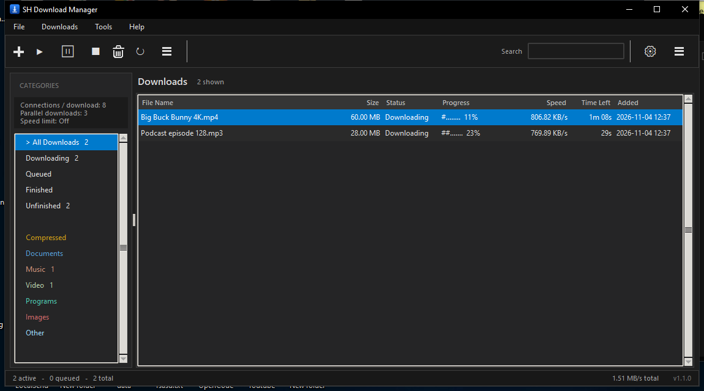
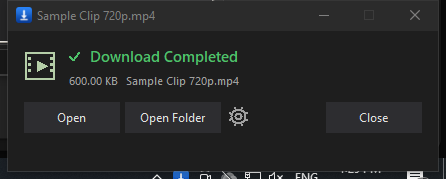
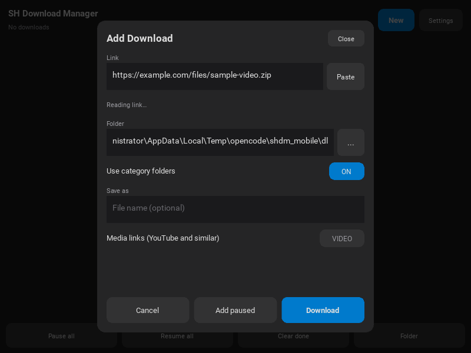
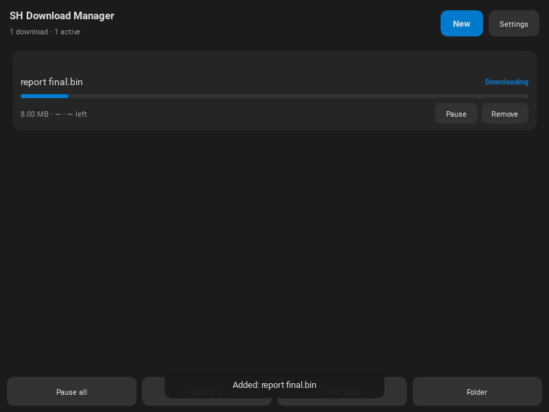
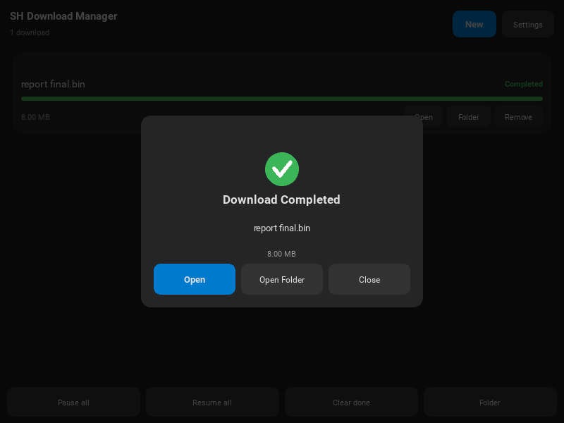
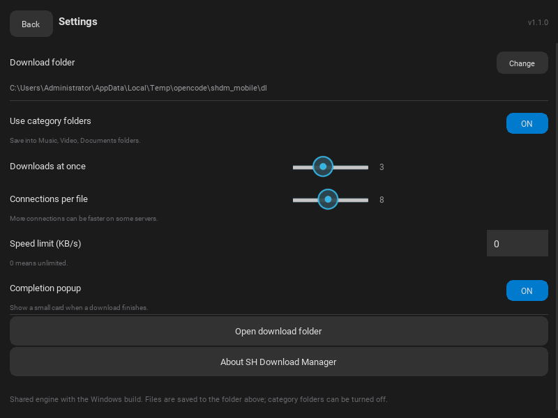

# SH Download Manager

A fast, independent download manager for Windows and Android with segmented HTTP/HTTPS transfers, resume, queues, a media grabber and optional browser integration.



SH Download Manager is an original implementation. It is **not** affiliated with, endorsed by, or derived from Tonec Inc. or Internet Download Manager. See [ANALYSIS.md](ANALYSIS.md) for the clean-room analysis that informed the feature set.

## Features

- Multi-connection segmented downloads using HTTP `Range` requests.
- Dynamic part splitting when a connection finishes early.
- Pause, resume and restart after a crash or reboot.
- Automatic retry with backoff for transient server errors.
- Redirect, `Content-Disposition`, ETag and `Last-Modified` handling.
- Single-stream fallback when the server does not support ranges.
- Queue with configurable parallel downloads and connections per file.
- Optional global speed limit.
- Category folders for compressed files, documents, music, video, programs and images.
- Search, sorting and filters by status or category.
- Media Grabber that finds links, video, audio and image sources on a page.
- Batch downloads with `[1-50]` / `[001-050]` range expansion (`File → Batch download...`, `Ctrl+Shift+B`).
- YouTube and similar media pages through yt-dlp, with video quality (4K down to 144p) and audio-only choices.
- On-page "Download this video/audio" panel from the browser extension, listing the available qualities.
- Localhost browser API and a bundled Chrome/Edge Manifest V3 extension.
- Drag and drop: drop a link (or a `.url`, `.txt` or `.html` file) anywhere on the
  window to open the Add Download sheet; several links are queued at once.
- Add Download sheet with a live size check, category, folder history, editable
  file name and separate **Add** (queue) / **Download** (start now) buttons.
- "Download Completed" window when a file finishes, with **Open**, **Open Folder**,
  a Settings button and **Close** (can be turned off in Settings).
- `shdm://` link handler, clipboard monitoring (off by default) and launch-at-sign-in support.
- Per-download referer and cookie headers for signed-in sites.
- Proxy modes: system, direct or manual.
- Android app (Kivy) with the same engine: download list with progress and
  pause/resume, Add sheet with link size check, folder picker and settings.
- Android share sheet integration: share a link from any browser to start a
  download, no copy/paste needed.
- Small "Download Completed" card on Android with **Open** and **Open Folder**.

## Requirements

**Using the built app:** Windows 10 or 11, no Python installation required.

**Android:** Android 5.0 (API 21) or newer on a 64-bit ARM device. The APK is
built by GitHub Actions (see [Android](#android)).

**Running from source:** Windows, Python 3.11+ and:

```powershell
python -m pip install requests pillow yt-dlp tkinterdnd2 pyinstaller
```

Media pages (YouTube and similar sites) use `yt-dlp`. Merging 1080p and higher video with audio also needs `ffmpeg` on `PATH` (or in `C:\ffmpeg\bin`); without it the quality list only offers streams that download as a single file, plus audio-only.

## Run from source

```powershell
cd "I:\Projects\REA\SH Download Manager"
python src\run.py
```

You can also pass URLs directly:

```powershell
python src\run.py "https://example.com/file.zip"
python src\run.py --minimized "https://example.com/file.zip"
```

## Build the executable

```powershell
cd "I:\Projects\REA\SH Download Manager"
powershell -ExecutionPolicy Bypass -File build.ps1
```

The script runs PyInstaller with `SH Download Manager.spec` and copies the finished one-file executable to:

```text
I:\Projects\REA\SH Download Manager\SH Download Manager.exe
```

`build.ps1` also supports a clean build:

```powershell
powershell -ExecutionPolicy Bypass -File build.ps1 -Clean
```

## Build the installer

```powershell
powershell -ExecutionPolicy Bypass -File installer\build_installer.ps1
```

Options: `-RebuildApp` runs `build.ps1` first, `-FfmpegRoot <folder>` points at a
folder containing `bin\ffmpeg.exe` (default `C:\ffmpeg`) and `-NoOpen` keeps
Explorer closed. The result is `SH Download Manager Setup.exe` in the repo root.

## Browser extension

The installer copies the extension to `C:\Program Files\SH Download Manager\browser_extension`
and the app keeps a fresh copy in `%APPDATA%\SHDownloadManager\browser_extension`.

Chrome and Edge do not allow silent extension installation, so it has to be added
once by hand:

1. Start the app and keep **Settings → Integration → Enable local browser integration API** enabled.
2. Open `chrome://extensions` or `edge://extensions`.
3. Enable **Developer mode**.
4. Choose **Load unpacked** and select the `browser_extension` folder.

The app can open the folder for you from **Tools → Open browser extension folder**. See `browser_extension/README.md` for permissions and usage.

The extension sends the URL, referer and cookies for the selected link to `127.0.0.1:53991`. Nothing is sent to a remote server.

The installed copy also ships `extension-setup\Add-Browser-Extension.cmd`, which
opens `chrome://extensions` / `edge://extensions`, copies the extension folder path
to the clipboard and shows the three steps above.

## Using the app

- **Add URL** or `Ctrl+N` opens the Add Download sheet: the link is checked for
  size and file name, the category chooses the folder, and **Add** queues it while
  **Download** starts it immediately.
- Drag a link from any browser (or a `.url`, `.txt` or `.html` file) anywhere onto
  the window to open the same sheet; dropping several links queues them all.
- **Batch download** (`File → Batch download...` or `Ctrl+Shift+B`) adds many links at once. `https://example.com/file[001-050].zip` expands to 50 links; keep the checkbox off to add the lines literally.
- **Start / Resume**, **Pause** and **Remove** act on the selected rows. `Space` toggles pause/resume.
- Double-click a completed item to open the file; double-click an unfinished item to open its folder.
- Right-click a row for the same actions plus **Copy URL**.
- When a download finishes, a **Download Completed** window appears above the
  taskbar: **Open** launches the file, **Open Folder** shows it in Explorer, the
  gear opens Settings, and **Close** dismisses it. It also appears while the app
  sits in the tray, and Settings can turn it off. Several files finishing
  together queue up one after another.
- The sidebar filters by status or category; the search box filters by file name or URL.
- **Media Grabber** (`Ctrl+G`) analyzes a page and lists downloadable files and media sources.
- **Settings** (`Ctrl+,`) changes folders, connections, retries, proxy, speed limit, categories, clipboard monitoring and integration.
- Closing the window pauses active downloads and saves their state for the next launch.



### Accepted links

Ordinary files use `http://` or `https://` links. FTP, torrents and streaming manifests (HLS/DASH) are not reconstructed.

Links to supported media pages (YouTube, Vimeo, SoundCloud, Facebook, Instagram, TikTok, X/Twitter, Twitch and others) are downloaded with yt-dlp. Adding a plain YouTube link starts the best video+audio download; the extension panel and `POST /formats` expose the per-quality choice.

## Data locations

- Settings: `%APPDATA%\SHDownloadManager\settings.json`
- Download state: `%APPDATA%\SHDownloadManager\downloads.json`
- Default downloads: `%USERPROFILE%\Downloads`, organized into category folders.
- Partial files: `<target name>.shdm-part` next to the target file.

Completed downloads are normal files and are not modified after completion.

## Project layout

```text
src/run.py                 Source entry point
src/shdm/app.py            Tkinter/ttk user interface and dialogs
src/shdm/engine.py         Segmented download engine, scheduler and persistence
src/shdm/settings.py       Defaults, categories and settings persistence
src/shdm/api.py            Localhost HTTP API for the browser extension
src/shdm/grabber.py        Page link extraction and probing
src/shdm/ytdl.py           yt-dlp format listing and media-page downloads
src/shdm/util.py           Formatting, safe file names and path helpers
tests/test_server.py       Local range/throttle/redirect/503 test server
tests/test_engine.py       Engine integration tests
browser_extension/         Chrome/Edge Manifest V3 extension
assets/                    Application and extension icons
build.ps1                  Build helper
SH Download Manager.spec   PyInstaller one-file spec
```

## Tests

The download engine has an integration suite that starts a local HTTP server and exercises real transfers:

```powershell
python tests\test_engine.py
```

Covered cases: multipart downloads, `Content-Disposition` and redirects, servers without range support, pause/resume integrity, retry after HTTP 503 and duplicate detection.

## Security notes

- The browser API binds to `127.0.0.1` only. It is not reachable from the network.
- Cookies sent by the extension are kept in the local download state so that resumed downloads keep working.
- The API accepts local requests from any origin for compatibility with unpacked extensions. Do not expose the port through a proxy or port forward.
- The app does not bypass DRM, paywalls or site access controls. Download only content you are allowed to save.

## Limitations

- No FTP/SFTP, BitTorrent, HLS/DASH segment reconstruction or DRM removal.
- No native messaging host; the extension uses the localhost API.
- No shell context-menu handler in this release (the extension and `shdm://` handler are provided instead).
- The tray icon, autostart, drag-and-drop and installer are Windows-only.
- Audio extraction on Android needs an `ffmpeg` binary, which is not bundled, so **AUDIO** downloads are saved as M4A. The Windows build bundles `ffmpeg` and converts to MP3.
- Android downloads keep running while the app is alive (a partial wake lock is held), but there is no foreground service yet, so the system may stop a transfer if it reclaims the app.

## Android

The mobile front end lives in `src/shdm/mobile/` and reuses the same engine,
settings, grabber and yt-dlp helpers as the Windows build. `main.py` at the
repository root is the Kivy entry point.

| | |
|---|---|
| Add Download |  |
| Downloads |  |
| Completion |  |
| Settings |  |

### Install the APK

Every push to `master` builds a debug APK in GitHub Actions:

1. Open the **Actions** tab → **Build APK** → latest run.
2. Download the `SH-Download-Manager-apk` artifact.
3. Unzip it and install `bin/shdm-1.1.0-arm64-v8a-debug.apk` on the device
   (allow "install unknown apps" for your file manager or browser).

Share a link from Chrome or any other browser to **SH Download Manager** and
the Add sheet opens with the URL filled in.

### Build locally

Buildozer cannot run on Windows (it refuses the Android target there). Use
Linux or WSL:

```bash
sudo apt install -y git zip unzip openjdk-17-jdk autoconf libtool pkg-config \
  zlib1g-dev libncurses5-dev libncursesw5-dev libtinfo5 cmake libffi-dev \
  libssl-dev libltdl-dev
pip install buildozer "cython==0.29.36"
buildozer -v android debug
```

The APK is written to `bin/`. Buildozer downloads the Android SDK/NDK on the
first run, so the initial build takes a long time.

### Where files go

The app writes to `Download/SH Download Manager` when that folder is writable,
otherwise to its app-specific external folder
(`Android/data/org.shdownloadmanager.shdownloadmanager/files/Downloads`). The
completion card and Settings both offer **Open Folder**.

### Architecture

```text
main.py                        Kivy entry point (Android and desktop preview)
src/shdm/engine.py             Shared download engine
src/shdm/mobile/app.py         App object, completion queue, wake lock
src/shdm/mobile/screens.py     Downloads and Settings screens
src/shdm/mobile/dialogs.py     Add, folder picker, completion, details, about
src/shdm/mobile/device.py      Storage, permissions, share intent, open file
src/shdm/mobile/theme.py       Dark palette and drawn widgets
buildozer.spec                 python-for-android configuration
android_intent_filters.xml     Share-sheet intent filter
android_extra_application.xml  FileProvider for Open / Open Folder
android_res/xml/file_paths.xml FileProvider paths
```

Preview the mobile UI on the desktop (needs `python -m pip install kivy`):

```powershell
python main.py
```
